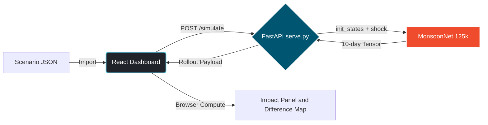
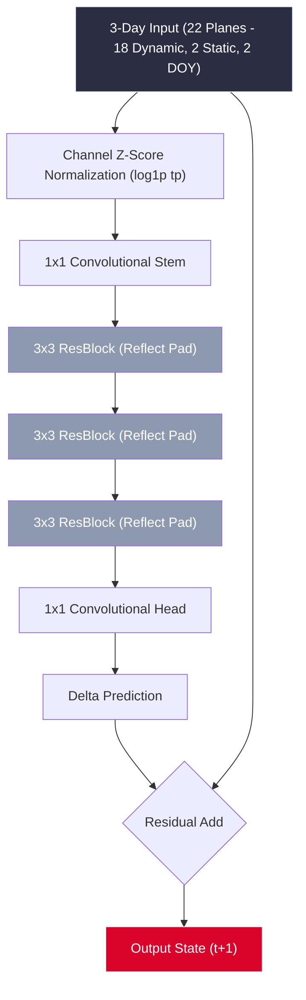

# ⛈️ Vaayu (Monsoon Twin)

**An Edge-Capable, Physics-Aware Earth-System Digital Twin of the Indian Monsoon**

  

---

## 🌍 Overview

**Vaayu** is an offline-first Earth-System Digital Twin built for **Track 2: Multiverse of Monsoon**, performing autoregressive spatiotemporal emulation of India's daily atmosphere on a `32 × 36` (`1° × 1°`, `lat 6.5..37.5`, `lon 65.5..100.5`) domain across 6 physical state variables (`t2m`, `tp`, `u10`, `v10`, `msl`, `tcwv`). Engineered for constrained CPU runtimes, Vaayu executes 10+ day deterministic rollouts and causal perturbation propagation experiments (such as localized Bay of Bengal warming or Arabian Sea wind stalls) in ~300 ms per call.

---

## 🧠 System Architecture

Vaayu decouples a lightweight, self-contained PyTorch inference engine from a browser-computed React visual analytics dashboard.



---

## 🌪️ Core Physics (Causality & Receptive Field)

Standard Vision Transformers (ViTs) and U-Nets rely on global attention or deep spatial downsampling, allowing localized anomalies to unphysically "teleport" across the subcontinent on Day 1. **MonsoonNet** (`125,126` parameters) enforces strict physical causality through a geometrically constrained receptive field.



- **Strict 3-Cell Receptive Field:** By stacking **exactly three `3×3` reflect-padded residual convolutions** without pooling, striding, dilation, or global operations, any single-cell perturbation is mathematically bounded to a 3-cell radius per autoregressive step, preserving fluid-dynamic locality before propagating outward over multi-day rollouts.
- **Physical-Unit Perturbations:** Shocks are added to `init_states[-1]` in raw physical units prior to normalization, guaranteeing byte-identical (`np.array_equal`) outputs for zero-perturbation calls and non-negative (`expm1` + clamp) precipitation fields.
- **Variance-Matched Curriculum Optimization:** Trained across a `1 → 2 → 4 → 8` step rollout curriculum with exogenous input noise (`σ = 0.02`), latitude-weighted (`cos(lat)`) MSE, heavy-rain (`> 10 mm/day`) emphasis, spatial-gradient L1 regularization, and logarithmic spatial variance matching to prevent multi-day smoothing.

---

## 🚀 Quickstart (Offline Serving)

The inference server is fully self-contained—weights, normalization statistics, and static topographic/land-sea buffers (`land_sea_mask`, `orography_m`) live inside the checkpoint with zero external network calls.

```bash
# 1. Environment Setup
python -m venv .venv
source .venv/bin/activate
pip install -r requirements.txt

# 2. Start Inference Server (0.0.0.0:8000)
python serve.py --port 8000

# 3. Validate API Contract
python -m monsoon_r1.schema_validator http://localhost:8000
```

---

## 🔬 Training Pipeline

The repository provides the full reproducible training, fine-tuning, and verification pipeline (requires `pip install -r requirements-train.txt`):

1. **Curriculum Rollout Training:**
   ```bash
   python -m train.train --dataset <PATH_TO_NETCDF> --out weights/monsoon.pt --epochs 16 --width 64 --lr 1e-3 --batch-size 32 --device auto
   ```
2. **Physical Shock Fine-Tuning:**
   ```bash
   python -m train.train_shock --dataset <PATH_TO_NETCDF> --checkpoint weights/monsoon.pt --out weights/monsoon_shock.pt --epochs 4 --horizon 8 --lr 2e-4 --batch-size 16 --w-t2m 2.5 --w-grad 0.1 --w-tcwv-cons 0.05 --shock-prob 0.5 --device auto
   ```
3. **Causality & Baseline Benchmarking:**
   ```bash
   python train/eval_skill.py --dataset <PATH_TO_NETCDF>
   python train/shock_eval.py --checkpoint weights/monsoon.pt --dataset <PATH_TO_NETCDF> --n-windows 10 --steps 8
   ```
4. **Unit Tests & Hygiene Scan:**
   ```bash
   python -m pytest -v tests/
   python tools/scan_repo.py --history .
   ```

---

## 📂 Repository Structure

- `serve.py` — Offline FastAPI inference server (`POST /health`, `POST /simulate`)
- `model/` — `MonsoonNet` architecture, `ChannelNormalizer`, deterministic `rollout`, and checkpoint utilities
- `train/` — Time-split data loader, curriculum trainer, localized shock fine-tuner, and evaluation scripts
- `weights/` — Self-contained model checkpoint (`weights/monsoon.pt`, tracked via Git LFS)
- `dashboard/` — Offline React/TypeScript/Three.js visual analytics dashboard
- `tests/` — Seeded synthetic unit tests, API contract tests, and scanner verification
- `tools/` — External scenario generator (`make_demo_inputs.py`) and repository hygiene scanner (`scan_repo.py`)
- `docs/` — API contract and integration log (`docs/INTEGRATION.md`)
